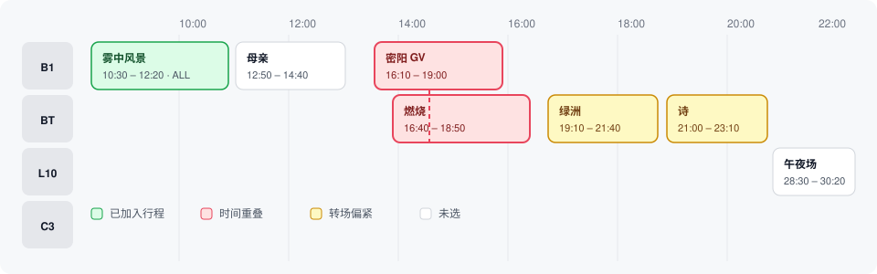
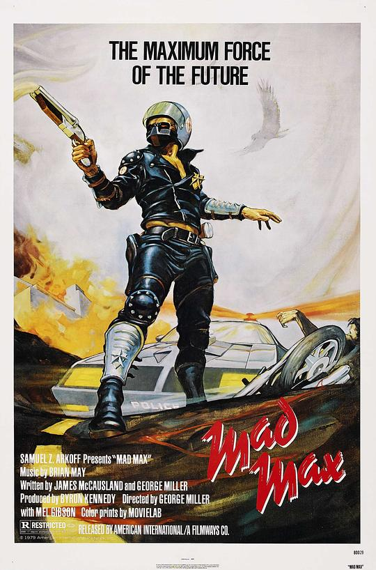
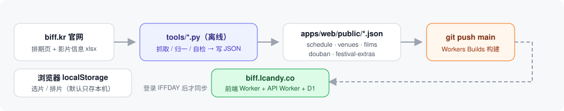

# BIFF Scheduler · 釜山电影节排片工具

把[釜山国际电影节](https://www.biff.kr/)的官方排期表，变成一张**可点选的甘特网格**：

> **选片 → 冲突检测 → 双方案（A/B）对比 → 导出 `.ics` 进手机日历 → 一键跳豆瓣**

前端 React + React Router + React Spectrum S2，数据本地优先：访客可离线使用，登录 IFFDAY 后可跨设备同步。前后端用 npm workspaces 分离，分别部署为 Cloudflare Workers；后端 Hono + Drizzle ORM + D1。

[](https://biff.lcandy.co)
[](https://vitejs.dev/)
[](https://workers.cloudflare.com/)
[](./apps/web/tests)

---

## 一、界面速览

**排片网格** —— 横轴是时间、纵轴是影厅，点一下就把场次收进行程；红 = 时间重叠、黄 = 转场偏紧、绿 = 已加入。跨午夜场次用 **24+ 时制**（`28:30` = 次日 04:30），不对小时取模。



**影片库** —— 2026 基线 **250 部**，174 部带本地海报（离线缓存，现场断网也看得到），支持中文名 / 原始片名 / 场次 code / 单元 / 导演搜索，行内展开它的全部场次并「定位 ▸」跳回网格。

|  |  |  |  |
|---|---|---|---|
|  |  |  |  |

<details>
<summary>还有这些视图</summary>

- **我的行程**：按日分组，重叠的几场折叠成一张**绿框顺位卡**（拖动即排「先保哪一场」），顶部把「每个冲突组各取一场」的全部**无冲突组合**并列成方案对比。
- **我的选片**：与「我的行程」是同一份数据的两个视图，永远一致。
- **红黑榜**：全站贴纸投票的红榜 / 黑榜 TOP50，可导出**分享长图**（红榜 / 黑榜各一张，双栏排版）。
- **看片计划海报 / 热门榜**：把排期导出成一张竖版长图；热门榜按「想看人数」排。
- **抢票信息**：开票倒计时（同时给北京 / 韩国两个时区）、票价、节目嘉宾，可导出 `.ics` 提醒。

</details>

---

## 二、在线 / 本地

**在线**：打开 **https://biff.lcandy.co** 即可，无需注册、无鉴权（站点已 `robots.txt` + `<meta name="robots">` 禁收录）。

**本地**：

```bash
npm install
npm run dev          # Vite 开发服务器
npm run typecheck    # tsc --noEmit
npm run test         # vitest run（纯函数口径单测）
npm run build        # typecheck + lint + test + 各 workspace 构建
npm run preview      # 构建后用 wrangler dev 起本地 Workers 环境
```

> 访客数据留在浏览器；**片单默认只存本机**，只有主动登录 IFFDAY 后才同步到该账号自己那份（详见 [`docs/account-integration.md`](./docs/account-integration.md)）。

---

## 三、数据从哪来

部署链路与抓取脚本无关：运行时数据就是仓库里**已检入**的静态 JSON，`npm run build` 时原样拷进 `apps/web/dist/`。



| 文件 | 内容 | 由谁产出 |
|---|---|---|
| `schedule.json` | 全部场次（时间 / 影院 / GV / 分级 / 字幕 / 片长…） | `tools/scrape_biff_web.py`（抓 biff.kr 官网排期页，现役口径） |
| `venues.json` | 影厅清单（厅 id / 影院 / 分区 / 官方代码） | 同上 |
| `films.json` | 影片目录（片名 / 单元 / 年份 / 国家 / 导演 / 豆瓣分） | `tools/build_films.py`（官方影片信息 xlsx） |
| `douban.json` | 豆瓣映射（可为空 → 全站走搜索兜底） | `tools/build_douban_map.py`（豆瓣官方 API，**离线跑**） |
| `douban-related.json` / `douban-intros.json` | 豆瓣相关电影 / 简介 | `tools/build_douban_related.py` / `build_douban_intros.py` |
| `festival-extras.json` | 开票批次 / 票价 / 购票须知 / 节目嘉宾 / 开闭幕式 | `tools/scrape_biff_extras.py` |

所以 **clone 下来直接 `npm run build` 就有完整数据** —— 不需要 Python、不需要 PDF、不需要任何解析步骤。只有**换一届 / 更新数据**时才跑离线管线，产物检入仓库。

**仓库内置的是第 31 届（2026）真实数据**：**750 场 / 26 厅 / 10 天（10/6–10/15）/ 250 部影片**。2025 第 30 届的 699 场仍在 git 历史里。

两个已明示、不糊过去的数据缺口：9 场片长是 120min 估算值（官网无详情页）；片名桥接 92%（750 场里 693 场拿到中文名，其余是联映块与活动场）。

---

## 四、技术栈

| 层 | 选型 |
|---|---|
| 构建 / 语言 | **Vite 6** + **TypeScript 5**（`tsc --noEmit` 是构建前置门禁） |
| 前端 | **React + React Router + React Spectrum S2**；旧版保留在 `/legacy/` |
| 样式 | **Tailwind v4**（增量双轨：不引 preflight，token 是唯一色源） |
| 主题 | 三态（跟随系统 / 亮 / 暗），`<head>` 内联脚本防首屏闪白 |
| 测试 | **Vitest**（纯函数口径）+ **ESLint 10**，同为 `npm run build` 门禁 |
| 部署 | **Cloudflare Workers**：前端 `biff-scheduler-web`、API `biff-scheduler`，共享 `biff.lcandy.co` |
| 离线 | **PWA**（`vite-plugin-pwa`），预缓存产物 + 只读 JSON → 现场断网可用 |
| 后端 | **Hono + Drizzle ORM + D1**（账号、资料、片单同步） |

**核心口径**：全站唯一数据源是「一部片一条记录」（`film_key → { picks[], note }`）；「我的选片」与「我的行程」是它的两个视图。冲突检测、方案枚举、`.ics` 生成、GV 映后时长、24+ 时制都是**纯函数**且有单测覆盖。

---

## 五、开发与部署

**唯一常规路径 = `git push origin main`**：Workers Builds 跑 `npm run build`（typecheck → lint → 单测 → 构建），失败即不上线；成功后自动迁移 D1 并**先部署 API Worker、再部署前端 Worker**。GitHub CI 随后跑 `check:ci` 与全量三浏览器 E2E（非阻塞事后体检）。

```bash
npm run verify:quick   # push 前想先知道结果：check:repo + typecheck + lint + 单测
npm run verify:ui -- e2e/react/<spec>.spec.ts --project=desktop-chromium   # 只跑一个 spec
npm run verify:deploy -- --sha <你 push 的那笔 sha>                        # 上线核对（构建 SHA / asset hash）
```

> ⚠ **禁止** `wrangler pages deploy` 直传（旧 Pages 项目已不在访问链路上）；`npm run deploy` 只是 Cloudflare 侧不可用时的手动兜底。

**改代码前必须先读** [`AGENTS.md`](./AGENTS.md)（开发规范·强制）：先 PLAN → 实现 → 写测试 → 推送；提交前必过 code review；15 条红线。完整版见 [`docs/DEVELOPMENT-STANDARDS.md`](./docs/DEVELOPMENT-STANDARDS.md)，口径细节见 [`docs/CONVENTIONS.md`](./docs/CONVENTIONS.md)。

---

## 六、目录结构

```
├─ apps/web/            # Vite 前端：src、public（只读 JSON + 海报）、tests
├─ apps/api/            # Hono API：src/db、migrations、Drizzle 与 Wrangler 配置
├─ packages/contracts/  # 前后端共享接口与数据序列化
├─ e2e/                 # Playwright E2E（react / 原联调）
├─ tests/               # 数据库兼容性检查
├─ tools/               # 离线数据管线（Python，仅在更新数据时用）
├─ scripts/             # 本地联调、部署核对、仓库自检
├─ skills/              # 固化的项目能力（SKILL.md）
├─ docs/                # 工程约定、账号接入、PLAN 归档
└─ AGENTS.md · PLAN.md  # 规范入口 · 当前状态与决策
```

---

## 七、许可与说明

- 排期 / 场次信息来自 biff.kr 公开页面，**仅作个人非商用排片参考**，不收费、不对外分发。
- `apps/web/public/brand/` 下的 BIFF 官方素材版权归 BIFF 组委会；README 里的海报缩略图是随站点离线部署的豆瓣图床缓存，版权归各自权利人 —— 如转为商业或公开大规模用途，请移除并替换为自有素材。
- 登录使用 HttpOnly 会话 Cookie；显示名称 / 头像 / 简介由 IFFDAY 账号系统管理。

**Unofficial fan tool, not affiliated with Busan International Film Festival.**
